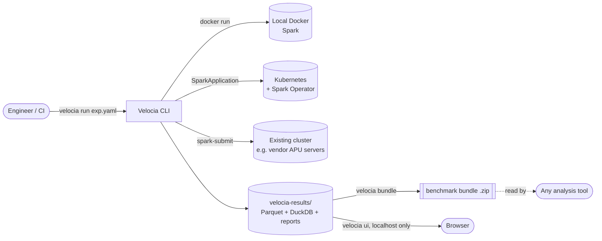
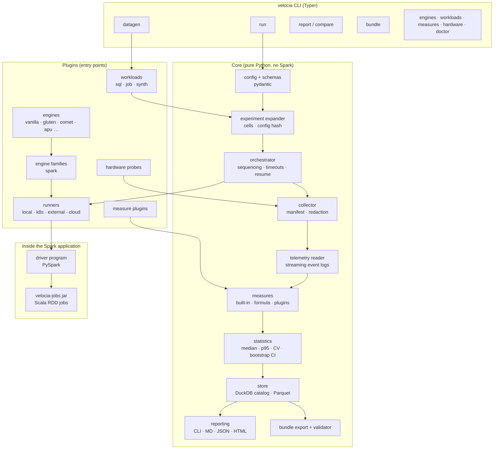
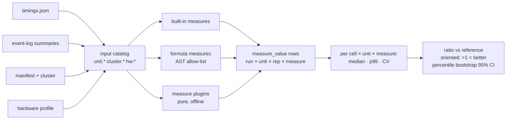
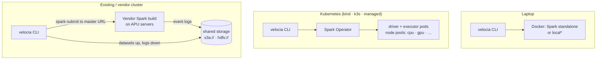
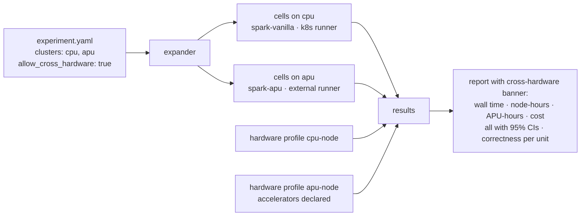

# 06 — Design

How Velocia for Apache Spark is built. The spec (`01`–`05`) says *what*; this document says *how*: components, flows, module layout and the key mechanisms. Diagrams are Mermaid (rendered by GitHub and MkDocs).

Status: approved 2026-10-21. Decisions marked **D-n** are listed in `plan/00-overview.md`.

## 1. System context

Velocia is a CLI on a workstation or CI machine. It drives Spark clusters it creates (Docker, Kubernetes) or that already exist (`external`), and writes everything to a local results directory. Nothing calls Velocia, and Velocia calls no other analysis tool; the bundle file is the only way out.



## 2. Components



| Component | Responsibility | Spec |
| --- | --- | --- |
| config | Load and validate `velocia.yaml`, experiments, engines, measures, hardware profiles; export JSON Schemas | 04 §2–4 |
| expander | YAML → cells; stable `cell_key` and `config_hash`; dry-run estimates | 03 §3 |
| orchestrator | Runs cells one at a time; quiet check; per-unit timeouts; resume from the catalog | 03 §4–5 |
| runners | Create or reach a cluster; submit; wait; collect; tear down | 03 §4 |
| engine family `spark` | Builds the submission; ships the driver program; defines the unit tag; reads event logs; defines checksums | 03 §4, §7 |
| driver program | Executes units, tags and times them, runs the correctness pass, writes `timings.json` and `checks.json` | 03 §4–5 |
| collector | Gathers logs and timings, writes `manifest.json`, redacts secrets before anything touches disk | 03 §4, §7 |
| telemetry reader | Streams event logs line by line into per-unit summaries | 03 §7 |
| measures | Computes every selected measure per unit and repetition | 03 §6 |
| statistics | Medians, p95, CV, oriented ratios with bootstrap CIs, correctness roll-up | 03 §5 |
| store | DuckDB catalog and Parquet results | 03 §8 |
| reporting / bundle | Reports, `compare`, bundle export and validation | 03 §9–10 |

## 3. Run lifecycle

```mermaid
sequenceDiagram
  autonumber
  participant U as User
  participant O as Orchestrator
  participant R as Runner
  participant D as Driver program (in Spark)
  participant C as Collector
  participant S as Stats + Store

  U->>O: velocia run exp.yaml
  O->>O: validate · expand cells · skip cells already done (resume)
  loop each cell, one at a time
    O->>R: quiet check
    R-->>O: ok / flagged
    loop each repetition (cold: new app per rep; warm: one app, warm-up discarded)
      O->>R: submit(cell, units, run_id)
      R->>D: spark-submit with driver + jars + conf
      loop each unit
        D->>D: setJobDescription("velocia:run:unit:rep") · execute into sink · time
      end
      D-->>R: timings.json
      R-->>O: finished / timeout / failed
      O->>C: collect(event logs, timings)
      C->>C: redact · write manifest.json
    end
    O->>R: correctness pass (untimed)
    R->>D: run checksums / job validators
    D-->>O: checks.json
    O->>S: read telemetry · compute measures · statistics vs reference
  end
  O->>U: CLI summary · report path
```

Failure handling: every runner call has a timeout; a unit timeout marks that unit `timeout` and continues with the next unit; an application failure marks the remaining units `failed` and moves to the next repetition; `teardown()` runs in a `finally` path. All state transitions are written to the catalog before the next step, which is what makes `--resume` work.

## 4. Module layout

```
velocia/                       # Python package
  cli/                         # Typer commands, one module per command
  config/                      # pydantic models, loaders, JSON Schema export
  experiment/                  # expander, Cell, cell_key, config_hash, estimates
  orchestrator/                # run loop, resume, timeouts, quiet check
  runners/                     # base.Runner, local.py, k8s.py, external.py
  families/spark/
    submission.py              # cell → spark-submit / SparkApplication spec
    driver/                    # PySpark driver program (shipped at submit time)
    eventlog/                  # streaming reader, per-unit aggregation, fallback markers
    checksum.py                # checksum SQL generation and rounding rules
  engines/                     # registry; loads engines/*.yaml
  workloads/
    sql/tpch/, sql/tpcds/      # query files (generated text, never vendored kits)
    jobs/                      # job workload definitions (units, validators)
    synth/                     # generator spec, sweep definitions
  datagen/                     # DuckDB TPC generators; Spark-side generator launcher
  measures/                    # builtins.py, formula.py (AST allow-list), registry
  hardware/                    # probes, profiles, hardware_manifest_hash
  collect/                     # collector, manifest, redaction
  stats/                       # summary.py, bootstrap.py
  store/                       # catalog.py (DuckDB), results.py (Parquet)
  report/                      # cli.py, markdown.py, json.py, html/ (Jinja2 templates)
  bundle/                      # export.py, schema/, validate.py
  ui/                          # v0.2: FastAPI app + built React assets
jvm/velocia-jobs/              # sbt project: Velocia.unit helper, TeraSort, Sort, WordCount, PageRank
engines/<name>/                # Dockerfile + <name>.yaml
schemas/                       # published JSON Schemas (experiment, results, bundle)
tests/                         # unit, golden, integration, planted faults
docs/                          # spec, design, plan, user docs (MkDocs)
```

Dependency rule: `stats`, `measures`, `store`, `report`, `bundle` and `families/spark/eventlog` never import PySpark and are fully unit-testable without a cluster.

## 5. Key mechanisms

### 5.1 Shipping the driver program (D-1)

The driver program and `velocia-jobs` jar are **shipped at submit time** (`--py-files velocia-driver-<hash>.zip`, `--jars velocia-jobs_<scala>-<ver>.jar`), not baked into engine images. Engine images then hold only the engine, and the same driver runs on vendor clusters (`external`) whose images we can't change. The driver zip hash and jar hash go into the manifest (ADR-3).

### 5.2 Unit tagging and timing

- Tag: `velocia:<run_id>:<unit_id>:<rep>` set with `SparkContext.setJobDescription` before the unit and cleared after; every Spark job and SQL execution of that unit carries it into the event log.
- Wall time: measured in the driver with a monotonic clock around the unit, which includes planning; the event-log SQL execution time is kept as a separate metric.
- Python helper `with velocia.unit("name")` and Scala `Velocia.unit("name") { ... }` do the same for jobs.
- Opaque third-party jobs: one unit = the whole application, timed from `SparkListenerApplicationStart` to `ApplicationEnd`.

### 5.3 Correctness

- SQL: the driver wraps the query: `SELECT count(*), sum(xxhash64(round(c1, p), c2, …)) FROM (<query>)`, rounding float/double/decimal columns. Run once per cell, untimed. Compare `(rows, checksum)` with the reference engine's cell.
- Jobs: the workload's validator runs on the job's output in an untimed pass (TeraValidate-style sortedness plus checksum; tolerance comparisons for PageRank/KMeans).
- States: `pass`, `fail`, `not_checked` (with reason). A `fail` turns the cell's results red everywhere and excludes it from "best engine" summaries.

### 5.4 Event-log reader

Line-by-line JSON over plain or zstd streams (rolling directories read in order). A small state machine keyed by job ID → job description tag accumulates task metrics per unit; memory grows with live jobs and stages, never with log size. Redaction runs on `SparkListenerEnvironmentUpdate` and any property map before anything is persisted. Fallback markers: count of row↔columnar transition nodes in the SQL plan of each unit, plus task-time share of stages with no accelerated operators.

### 5.5 Measures and statistics



Bootstrap: resample candidate and reference repetitions independently (10,000 resamples, seeded), compute the ratio of medians per resample, take the 2.5/97.5 percentiles. With n < 5 the CI is still computed but flagged. The seed goes into the results so reports are reproducible bit for bit.

### 5.6 Hardware manifest hash

`hardware_manifest_hash = sha256` of a canonical JSON of, per node type: CPU model, cores, memory (rounded to GiB), disk type, accelerator model/count/driver version, plus node count and the `declared`/`detected` flag. Hostnames, timestamps and free disk are excluded so the same hardware hashes the same across days. Comparisons and `compare` match on this hash.

## 6. Deployment topologies



## 7. CPU vs APU experiment (worked example)



Before the first cell, `velocia engines check spark-apu --cluster apu` runs the smoke test; the experiment refuses to start on that cluster until it has passed for the same engine definition and cluster config.

## 8. Security and privacy in the design

- Redaction is a single module (`collect/redaction.py`) with a deny-list of key patterns (`*password*`, `*secret*`, `*token*`, `*key*`, credentials providers) plus user-supplied patterns, applied on read in the event-log reader and before writing manifests, reports and bundles. Planted-secret tests cover every writer.
- Credentials for runners (kubeconfig, object storage, cloud) come only from the environment and are never written to manifests.
- No network calls except to the user's own clusters and storage named in the experiment.
- Formula measures are parsed, never executed.

## 9. What is deliberately not designed yet

- Non-Spark families (v1.x): only the `Family` interface is fixed; its first implementation will validate it.
- Cloud runner provider choice (v0.3).
- Viewer UI details (v0.2).
