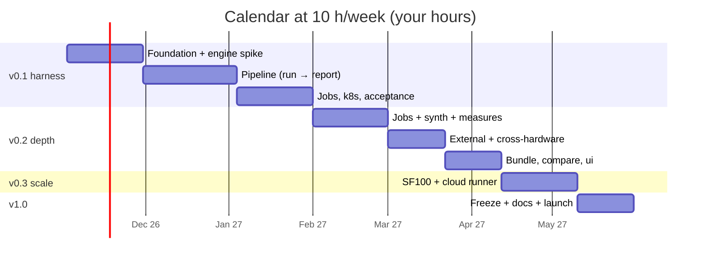
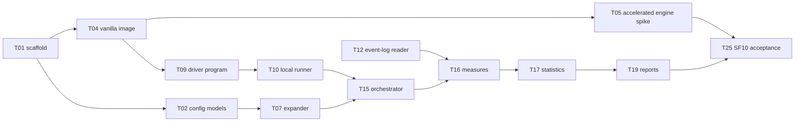

# Implementation plan — overview

Status: **approved 2026-10-21**, including decisions D-1 to D-13 as proposed.

## How to read this plan

- One file per milestone: `01-v0.1-harness.md`, `02-v0.2-depth.md`, `03-v0.3-scale.md`, `04-v1.0-stable.md`.
- Tasks are at most one working day of Claude's coding time each. Every task lists its dependencies, the acceptance test that proves it done, and the spec section it implements.
- **Estimates are in your hours** (spec questions, review, testing, debugging), assuming Claude writes most of the code. At 10 effective hours a week, 10 h ≈ 1 calendar week.
- Uncertain tasks have a time-box and a fallback.

## Decisions to approve (spec review)

Contradictions, gaps and risky assumptions found while reading `01`–`06` and `CLAUDE.md`. All resolutions approved on 2026-10-21 and reflected in the spec (see `docs/CHANGELOG.md`).

| # | Finding | Proposed resolution |
| --- | --- | --- |
| D-1 | ADR-3 puts the driver program "inside the engine image", but the `external` runner can't change a vendor's image | Ship the driver zip and `velocia-jobs` jar at submit time for every runner; images hold only the engine (design §5.1). Update ADR-3 |
| D-2 | CLAUDE.md: "Velocia starts no services except the viewer", but the `local` runner starts Spark containers | Ephemeral Spark containers created for one run and always removed afterwards are not "services". Add this sentence to CLAUDE.md |
| D-3 | Acceptance "rerun reproduces each cell's median within its CI" is not guaranteed statistically, even on quiet hardware | Criterion: for ≥ 90% of cells, the rerun's median falls inside the first run's 95% CI, and no cell's ratio CI moves from "faster" to "slower"; checked on a quiet machine |
| D-4 | Goal "first comparison in under 30 minutes" conflicts with building Gluten/Comet images locally (often > 30 min) | Publish prebuilt engine images by digest (with upstream `NOTICE` files) to GHCR in v0.1; local builds stay optional |
| D-5 | Cold mode wants the OS page cache dropped; on Docker Desktop (macOS) and on external clusters that isn't possible | Best effort: drop where privileged (Linux local, k8s with a privileged init container); otherwise label "cold (cache not dropped)" |
| D-6 | Spark 4.x listed as supported, but accelerated engines track Spark 3.5 first | v0.1 pins Spark 3.5 for all engines; vanilla 4.x added once one accelerated engine supports it, as a separate compatibility row |
| D-7 | Which accelerated engine in v0.1? | Whichever of Comet or Gluten passes the smoke test first in the time-boxed spike (T05); Comet is tried first (single jar + conf) |
| D-8 | "Hardware manifest" comparability needs a definition, or everything differs | Define `hardware_manifest_hash` as in design §5.6 (no hostnames, timestamps or free disk) |
| D-9 | Rounding floats before hashing still flips at rounding boundaries | Keep rounding (default 4 decimals) and add per-workload tolerance mode (compare sorted, rounded results) for units that fail only by float noise; report which mode was used |
| D-10 | Bundles include event logs, which contain SQL text, file paths and sometimes literals | Keep them (tools need them), document it, add `velocia bundle --strip-sql` for sharing outside the team |
| D-11 | Scala jar adds a second build toolchain to v0.1 | Accept it for TeraSort (measuring the engine, not Python) but time-box T18; fallback: DataFrame TeraSort in v0.1, Scala in v0.2 |
| D-12 | Name "Velocia for Apache Spark" vs future non-Spark families; Velocia Inc. name conflict | Keep the name through v1.0; decide before announcing (launch checklist already requires a trademark opinion) |
| D-13 | APU access: the CPU vs APU experiment needs a reachable vendor cluster | Build and test `external` against a self-hosted standalone cluster + MinIO; the APU run is a v0.2 pilot that depends on access, not a release blocker |

## Milestones

| Milestone | Tasks | Your hours | Calendar at 10 h/wk | Exit criteria |
| --- | --- | --- | --- | --- |
| v0.1 — harness | 26 | 125 | ~13 weeks | `03 §11` v0.1 boxes all checked |
| v0.2 — depth | 22 | 96 | ~10 weeks | `03 §11` v0.2 boxes; CPU vs APU pilot if access exists |
| v0.3 — scale | 7 | 37 | ~4 weeks | SF100 on one cloud with budget cap |
| v1.0 — stable | 8 | 30 | ~3 weeks | Frozen interfaces, docs, launch checklist |
| **Total to v1.0** | **63** | **~288** | **~30 weeks** | |

Add 20–30% contingency for engine and cluster surprises: plan on 7–8 months to v1.0 and about 3 months to a usable v0.1.

## Critical path

The engine spike (T05) starts in week 1 in parallel with the core, because it is the largest unknown. The event-log reader (T12) and statistics (T17) need no cluster and can be built and tested in parallel with runner work.

## Risks and time-boxes

| Risk | Time-box | Fallback |
| --- | --- | --- |
| Comet/Gluten image doesn't work with Spark 3.5 build | T05: 2 days per engine | Try the other engine; if both fail, v0.1 ships vanilla-only plus a planted "fake accelerated" engine and moves the real one to v0.2 |
| DuckDB `tpcds` at SF10 needs too much memory on a laptop | T08: 1 day | Generate TPC-DS from SF10 upward on the cluster with a Spark generator; laptop default stays TPC-H |
| Scala cross-build friction | T18: 2 days | DataFrame TeraSort (D-11) |
| Kubernetes CI flakiness (kind in GitHub Actions) | T20: 2 days | Nightly-only job with retries; PR CI stays Docker-only |
| No access to APU hardware | — | `external` runner proven on self-hosted standalone; APU pilot waits |
| Your available hours drop | — | Milestones are independently useful; v0.1 alone is a publishable tool |
